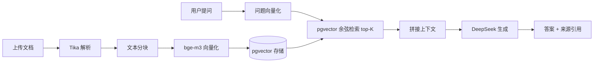

# 企业知识库问答系统

基于大模型的企业知识库问答系统（RAG, Retrieval-Augmented Generation）。上传企业内部文档（PDF / Word / TXT），系统自动解析、分块、向量化入库；用户用自然语言提问，系统检索最相关的片段，由大模型生成**带来源引用**的答案。

## 技术栈

| 层 | 技术 |
|---|---|
| 语言 | Java 17 |
| 框架 | Spring Boot 4.1.1 |
| AI 框架 | Spring AI 2.0.1（OpenAI 兼容协议） |
| 生成模型 | DeepSeek（deepseek-chat） |
| 向量模型 | 硅基流动 BAAI/bge-m3（1024 维） |
| 数据库 | PostgreSQL 16/17 + pgvector（HNSW 索引） |
| ORM | MyBatis 4.1.0 |
| 文档解析 | Apache Tika 2.9.2 |

## 架构与流程



## 核心流程

1. **文档解析** — Tika 将 PDF / Word / TXT 统一提取为纯文本
2. **文本分块** — 500 字符一块，相邻块重叠 50 字符，避免语义被切断
3. **向量化** — 调用 bge-m3 将每块文本转成 1024 维向量
4. **向量存储** — 向量以 pgvector 的 `vector` 类型入库，建 **HNSW** 近似最近邻索引
5. **检索** — 问题向量化后，用 pgvector 余弦距离（`<=>`）做 ANN 检索，取 top-K
6. **生成** — 检索片段拼入提示词，由 DeepSeek 生成答案并标注 `[资料N]` 来源

## 功能特性

- 文档上传与解析（PDF / DOCX / TXT）
- 文档管理（列表、详情、删除，级联删除分块与本地文件）
- RAG 问答（答案可追溯来源，附相似度得分）
- 统一响应体 + 全局异常处理

## 快速开始

### 1. 环境要求

- JDK 17+
- Maven 3.9+
- PostgreSQL 16/17（已安装 pgvector 扩展）

### 2. 初始化数据库

```sql
CREATE DATABASE knowledge_base;
```

在 `knowledge_base` 库中执行 `sql/init.sql`（自动启用 `vector` 扩展、建表、建 HNSW 索引）：

```bash
psql -U postgres -d knowledge_base -f sql/init.sql
```

### 3. 配置 API Key

设置环境变量（或直接改 `src/main/resources/application.yml`）：

| 变量 | 说明 |
|---|---|
| `DEEPSEEK_API_KEY` | DeepSeek 生成模型密钥 |
| `SILICONFLOW_API_KEY` | 硅基流动向量模型密钥 |
| `DB_USERNAME` | 数据库用户名（默认 `postgres`） |
| `DB_PASSWORD` | 数据库密码（默认 `123456`） |

### 4. 启动

```bash
./mvnw spring-boot:run
```

### 5. 上传文档并提问

```bash
# 上传
curl -X POST "http://localhost:8080/api/documents/upload" -F "file=@test-article.txt"

# 提问
curl -X POST "http://localhost:8080/api/chat" \
  -H "Content-Type: application/json" \
  -d '{"question":"什么是企业知识库问答系统?"}'
```

## API 接口

| 方法 | 路径 | 说明 |
|---|---|---|
| POST | `/api/documents/upload` | 上传文档（multipart file） |
| GET | `/api/documents` | 文档列表 |
| GET | `/api/documents/{id}` | 文档详情 |
| DELETE | `/api/documents/{id}` | 删除文档 |
| POST | `/api/chat` | RAG 问答 |

统一返回结构：

```json
{ "code": 0, "message": "success", "data": { } }
```

## 目录结构

```
src/main/java/org/example/aa/
├── common/        # 统一响应体、全局异常处理
├── controller/    # 接口层
├── service/       # 业务层（文档处理、向量化、检索、问答）
├── mapper/        # MyBatis 数据访问层
└── entity/        # 实体
```

## 技术亮点

- Spring Boot 4 的 Jackson 3 迁移适配
- pgvector HNSW 索引实现 ANN 向量检索
- RAG 检索增强生成，缓解幻觉与知识时效性问题
